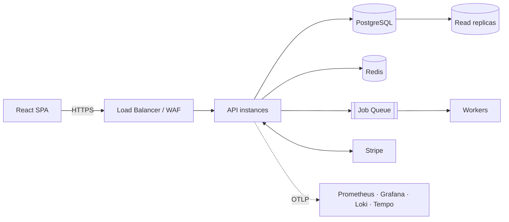
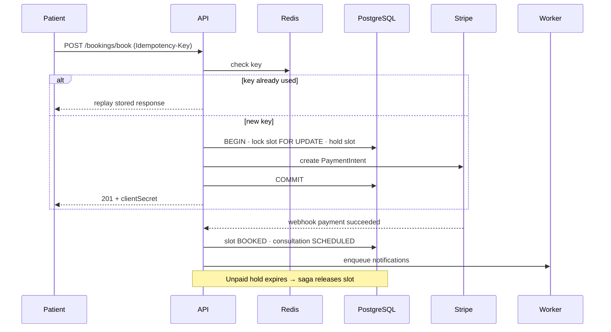
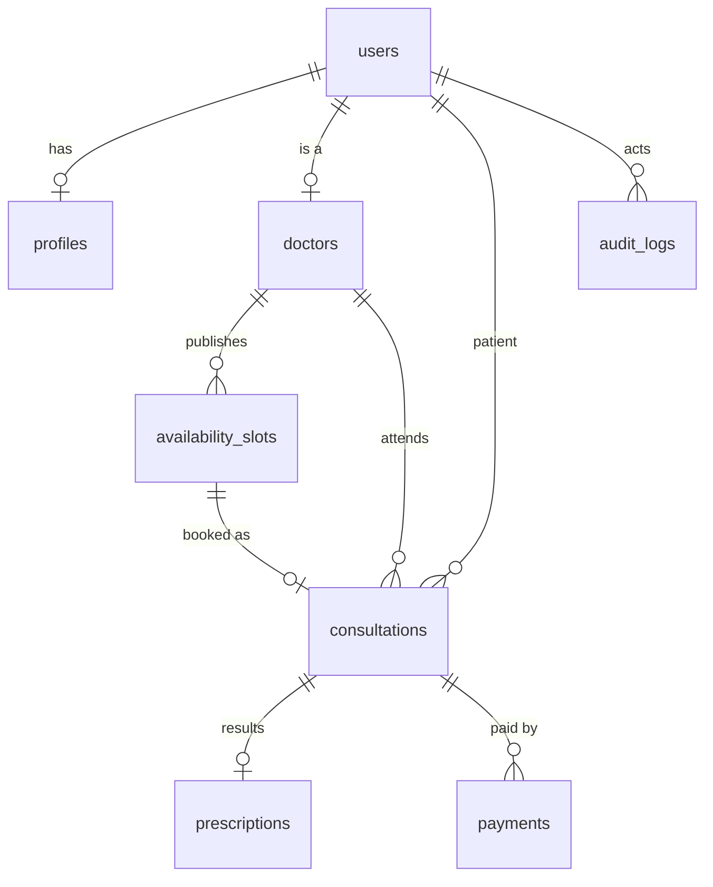

<div align="center">

# 🌿 MediBridge

### Amrutam CareConnect — Telemedicine Platform for Ayurvedic Consultations

Discover verified doctors · Book slots · Consult online · Get digitally signed prescriptions


[Features](#-features) · [Tech Stack](#-tech-stack) · [Getting Started](#-getting-started) · [API](#-api-reference) · [Architecture](#-architecture) · [Security](#-security) · [Roadmap](#-roadmap)

</div>

---

## 📖 About

**MediBridge** is a production-oriented telemedicine backend + web app built for the **Amrutam Backend Developer Assignment**. It focuses on **scalability, reliability, security and observability**, targeting **100k consultations/day**.

| Target | Value |
|---|---|
| 📈 Scale | 100k consultations / day |
| ⚡ Read latency | p95 < 200 ms |
| ✍️ Write latency | p95 < 500 ms |
| 🟢 Availability | 99.95 % |
| 🔐 Security | Encryption, MFA, RBAC |
| 👁️ Observability | Metrics, logs, traces |

🎥 **Demo video:** _add link here_

---

## ✨ Features

- 👤 **User lifecycle** — patient/doctor registration, JWT access + refresh tokens, TOTP MFA, roles: `PATIENT` · `DOCTOR` · `ADMIN`
- 🗓️ **Availability & booking** — doctors publish 30-min slots, patients book with symptoms/notes, **idempotent** booking via `Idempotency-Key`
- 🩺 **Consultation lifecycle** — `SCHEDULED → IN_PROGRESS → COMPLETED / CANCELLED`, meeting link
- 💊 **Prescriptions** — diagnosis, medications, instructions, follow-up date, digital signature + verification
- 🔎 **Search & filtering** — by name/condition, specialty, max fee, min rating, with pagination
- 🧾 **Compliance & audit trail** — actor, role, action, resource and IP recorded for protected actions
- 📊 **Admin analytics** — patient/doctor counts, verification queue, consultation overview

---

## 🛠 Tech Stack

| Layer | Technology |
|---|---|
| **Frontend** | React 19, React Router 7, Vite, Tailwind CSS 4, Axios, Stripe.js, Lucide |
| **Backend** | `<Node.js / Go / Python>` ← _fill in_ |
| **Database** | PostgreSQL |
| **Cache / Locks** | Redis _(optional)_ |
| **Payments** | Stripe |
| **Infra / CI** | Docker, Docker Compose, GitHub Actions |
| **Observability** | OpenTelemetry, Prometheus, Grafana, Loki |

---

## 📁 Project Structure

```bash
MediBridge/
├── backend/                 # API server
├── frontend/
│   ├── public/
│   └── src/
│       ├── components/      # common UI + layout (Navbar, Sidebar, ProtectedRoute)
│       ├── context/         # AuthContext, ToastContext
│       ├── pages/
│       │   ├── auth/        # Login, Register, MfaVerify
│       │   ├── patient/     # Dashboard, DoctorSearch, DoctorProfile, Appointments
│       │   ├── doctor/      # Dashboard, Availability, Appointments, ConsultationManage
│       │   └── admin/       # Dashboard, DoctorVerification, AuditLogs
│       └── services/        # axios client + API modules
├── docs/                    # openapi.yaml, architecture.md, security.md
├── infra/                   # docker-compose, IaC
└── .github/workflows/       # CI pipeline
```

---

## 🚀 Getting Started

### Prerequisites

- Node.js **≥ 20** and npm
- PostgreSQL **≥ 14**
- Redis **≥ 7** _(optional)_
- Docker & Docker Compose _(optional)_

### 1. Clone

```bash
git clone https://github.com/ashishpatel0856/MediBridge.git
cd MediBridge
```

### 2. Backend

```bash
cd backend
cp .env.example .env        # fill in values
npm install
npm run migrate             # run DB migrations
npm run dev                 # http://localhost:4000
```

### 3. Frontend

```bash
cd frontend
cp .env.example .env
npm install
npm run dev                 # http://localhost:5173
```

### 4. Docker _(once compose file is added)_

```bash
docker compose -f infra/docker-compose.yml up --build
```

### 5. Quick walkthrough

1. Create an **admin** user (seed script).
2. Register a **doctor** → admin verifies at `/admin/doctors`.
3. Doctor adds slots at `/doctor/availability`.
4. Register a **patient** → search doctors → book a slot.
5. Doctor starts consultation → issues prescription → completes it.
6. Admin checks `/admin/audit`.

---

## 🔑 Environment Variables

<details>
<summary><b>Frontend</b> — <code>frontend/.env</code></summary>

| Variable | Description |
|---|---|
| `VITE_API_BASE_URL` | API base URL, e.g. `http://localhost:4000/api/v1` |
| `VITE_STRIPE_PUBLISHABLE_KEY` | Stripe **publishable** key only |

</details>

<details>
<summary><b>Backend</b> — <code>backend/.env</code></summary>

| Variable | Description |
|---|---|
| `PORT` | API port (`4000`) |
| `DATABASE_URL` | PostgreSQL connection string |
| `REDIS_URL` | Redis connection string |
| `JWT_ACCESS_SECRET` / `JWT_REFRESH_SECRET` | Token signing secrets |
| `JWT_ACCESS_TTL` / `JWT_REFRESH_TTL` | e.g. `15m` / `7d` |
| `ENCRYPTION_KEY` | Field-level encryption key (use KMS in prod) |
| `PRESCRIPTION_SIGNING_KEY` | Prescription signature key |
| `STRIPE_SECRET_KEY` / `STRIPE_WEBHOOK_SECRET` | Stripe credentials |
| `CORS_ORIGINS` | Allowed frontend origins |
| `OTEL_EXPORTER_OTLP_ENDPOINT` | Telemetry collector |

</details>

> ⚠️ Never commit real secrets. Commit only `.env.example` and keep `.env` in `.gitignore`.

---

## 📡 API Reference

**Base URL:** `/api/v1` · **Auth:** `Authorization: Bearer <token>`

<details>
<summary><b>🔐 Auth</b></summary>

| Method | Endpoint | Description |
|---|---|---|
| POST | `/auth/register/patient` | Register patient |
| POST | `/auth/register/doctor` | Register doctor (unverified) |
| POST | `/auth/login` | Login (returns tokens or `requiresMfa`) |
| POST | `/auth/refresh` | Refresh access token |
| POST | `/auth/mfa/setup` | Start MFA enrolment |
| POST | `/auth/mfa/verify` | Complete MFA login |
| GET | `/auth/me` | Current user |

</details>

<details>
<summary><b>🧑‍⚕️ Doctors & Slots</b></summary>

| Method | Endpoint | Role |
|---|---|---|
| GET | `/doctors?specialty&maxFee&minRating&query&page&limit` | Any |
| GET | `/doctors/:id` | Any |
| PUT | `/doctors/profile` | Doctor |
| PATCH | `/doctors/:id/verify` | Admin |
| GET | `/slots?doctorId&availableOnly` | Any |
| POST | `/slots` | Verified doctor |

</details>

<details>
<summary><b>📅 Bookings</b></summary>

| Method | Endpoint | Notes |
|---|---|---|
| POST | `/bookings/book` | **Requires `Idempotency-Key` header** |
| POST | `/bookings/confirm-payment` | `{ paymentIntentId }` |
| GET | `/bookings` | Own bookings |
| GET | `/bookings/:id` | Participant only |
| PATCH | `/bookings/:id/status` | Doctor: `IN_PROGRESS` / `COMPLETED` / `CANCELLED` |

```http
POST /api/v1/bookings/book
Idempotency-Key: 6f1c9a52-0b7e-4f0a-9d65-3b1d1d1d2f10

{ "slotId": "…", "symptoms": "Acidity", "paymentMethod": "UPI" }
```

</details>

<details>
<summary><b>💊 Prescriptions, Audit & Analytics</b></summary>

| Method | Endpoint | Role |
|---|---|---|
| POST | `/prescriptions` | Doctor |
| GET | `/prescriptions/:consultationId` | Participant |
| POST | `/prescriptions/verify` | Authenticated |
| GET | `/audit` | Admin |
| GET | `/analytics/overview` | Admin |

</details>

**Response format**

```json
{ "data": { }, "pagination": { "page": 1, "limit": 12, "total": 120 } }
{ "error": { "message": "Slot already booked" } }
```

📄 Full OpenAPI spec: [`docs/openapi.yaml`](docs/openapi.yaml)

---

## 🏗 Architecture



<details>
<summary><b>Booking flow (sequence diagram)</b></summary>



</details>

<details>
<summary><b>Design decisions</b></summary>

| Topic | Approach |
|---|---|
| Concurrency | Row lock on slot + unique constraint on active consultation per slot |
| Idempotency | Key + request hash stored; unique `(user_id, key)` |
| Sagas | Hold slot → create payment → confirm → finalize; compensate on failure |
| Retries | Exponential backoff with jitter, DLQ for jobs |
| Caching | Redis cache-aside for doctor search/profile; never cache PHI |
| Partitioning | Monthly range partitions on `consultations`, `payments`, `audit_logs` |
| Async jobs | Notifications, PDFs, analytics, reconciliation |
| Rate limiting | Redis token bucket, stricter on `/auth/*` |

</details>

---

## 🗄 Data Model

Core tables: `users` · `profiles` · `doctors` · `availability_slots` · `consultations` · `prescriptions` · `payments` · `audit_logs`



> Update this diagram to match your actual migrations.

---

## 🔐 Security

| Area | Control |
|---|---|
| Authentication | Argon2id/bcrypt, short-lived JWT, rotating refresh tokens, TOTP MFA |
| Authorization | Server-side RBAC + object ownership checks |
| Data protection | TLS, encryption at rest, field-level encryption for PHI, key rotation |
| Input safety | Schema validation, parameterized queries |
| Abuse protection | Rate limiting, login lockout |
| Audit | Append-only, hash-chained `audit_logs` |
| Supply chain | `npm audit`, Dependabot, Trivy image scan, secret scanning |

<details>
<summary><b>OWASP Top 10 mapping</b></summary>

| OWASP | Mitigation |
|---|---|
| A01 Broken Access Control | RBAC, ownership checks, IDOR tests |
| A02 Cryptographic Failures | TLS, field encryption, KMS |
| A03 Injection | Parameterized queries, validation |
| A04 Insecure Design | Threat model, saga + idempotency |
| A05 Misconfiguration | Hardened containers, secure headers |
| A06 Vulnerable Components | Automated dependency scanning |
| A07 Auth Failures | MFA, lockout, token rotation |
| A08 Integrity Failures | Signed prescriptions, Stripe webhook verification |
| A09 Logging Failures | Structured logs, audit trail, no PHI in logs |
| A10 SSRF | Egress allow-list |

</details>

📄 Full checklist & threat model: [`docs/security.md`](docs/security.md)

---

## 👁 Observability

| Signal | Tools | Examples |
|---|---|---|
| Metrics | Prometheus + Grafana | RPS, p95 latency, error rate, queue depth |
| Logs | JSON → Loki | `requestId`, `userId`, route, status |
| Traces | OpenTelemetry → Tempo | API → DB → Stripe → worker |
| Alerts | Alertmanager | SLO burn, 5xx spike, replica lag |

---

## 🧪 Testing & CI/CD

```bash
# Frontend
cd frontend && npm run build

# Backend
cd backend && npm test
```

- ✅ Unit tests (services, validators)
- ✅ Integration tests (API + PostgreSQL)
- ✅ Concurrency test — parallel bookings of one slot → exactly one succeeds
- ✅ Idempotency test — same key twice → one booking
- ✅ RBAC / IDOR tests
- ✅ Load test (k6) against SLOs

**CI pipeline:** lint → test → build → `npm audit` → Docker build → Trivy scan → deploy

---

## 💾 Backup & Disaster Recovery

- WAL archiving + daily base backups, 35-day retention, encrypted, cross-region
- Point-in-time recovery
- **RPO ≤ 5 min · RTO ≤ 30 min** _(targets)_
- Warm standby in a second region, quarterly restore drills

---

## 🗺 Roadmap

- [ ] Commit backend source (currently an orphan gitlink)
- [ ] Generate `Idempotency-Key` once per booking attempt and reuse on retry
- [ ] Complete Stripe payment confirmation in UI
- [ ] Fix 401 interceptor (failed login redirect, refresh queue, token rotation)
- [ ] Add MFA enrolment screen
- [ ] Remove `.env` from Git, add `.env.example`
- [ ] Move refresh token to httpOnly cookie
- [ ] Debounce doctor search; paginate audit logs
- [ ] Add `docs/` (OpenAPI, architecture, security), CI, tests, infra
- [ ] Record 5-minute demo video

---

## 🤝 Contributing

1. Fork the repo
2. Create a branch: `git checkout -b feature/my-feature`
3. Commit: `git commit -m "feat: add my feature"`
4. Push and open a Pull Request

## 📄 License

Distributed under the MIT License.

## 👨‍💻 Author

**Ashish Patel** — [@ashishpatel0856](https://github.com/ashishpatel0856)
